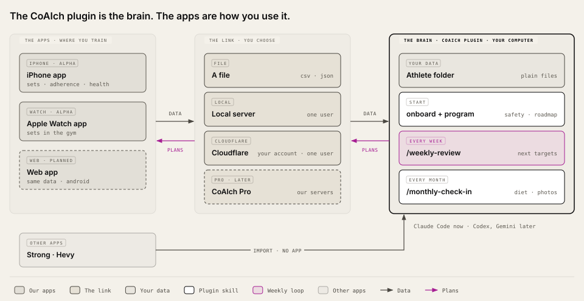

<picture>
  <source media="(prefers-color-scheme: dark)" srcset="docs/brand/banner-dark.svg">
  
</picture>

[](https://github.com/cubetes/coaich/actions/workflows/checks.yml)


**An evidence-based strength and nutrition coach that shows its work.** Every next weight, rep target and calorie
number comes with the reason for it, in plain words you can check. Your data stays with you.

> **For now CoAIch is built for iPhone and Apple Health users.** Android (Health Connect) comes later.
>
> **Pre-release.** "CoAIch" is a working name until the trademark search is done. The plugin is a preview, the
> iPhone and Watch apps are early alpha, the web companion is next. Release order: plugin, then web companion, then the apps. See the [roadmap](docs/roadmap.md) and the
> [changelog](CHANGELOG.md).

## Start here

From inside [Claude Code](https://claude.com/claude-code):

```
/plugin marketplace add cubetes/coaich
/plugin install coaich@coaich
```

Then, in an empty folder for your training, run `/onboard`. The [plugin guide](plugin/README.md) walks through
the rest, and `examples/demo-athlete` lets you try it with made-up data first.

## The plugin is the brain; the apps are how you use it

<picture>
  <source media="(prefers-color-scheme: dark)" srcset="docs/architecture-dark.svg">
  
</picture>

| Part | What it does | Where |
|---|---|---|
| **The apps**: iPhone and Watch (alpha), web (planned) | Where you train: record sets, sessions and adherence; show your training and diet plans, schedule and lift statistics. The iPhone app reads Apple Health. No coaching of their own. | Your phone, `iOS/`, `Watch/`, `LiveActivity/` |
| **The link**, your choice | Carries your data to the plugin and the plans back: a file, a server on your own computer, or one on your own Cloudflare account (one person per server), or later CoAIch Pro. Same data and same plans whichever you pick. | A file today. The open sync server, with setup guides for your own computer and for Cloudflare, is on the [roadmap](docs/roadmap.md). |
| **The plugin: the brain** (preview) | All the coaching: onboarding and safety, programs, next targets, weekly review and monthly check-in, nutrition, photo review, long-term roadmaps. | Your computer, in Claude Code today; OpenAI Codex and Google Gemini CLI planned: [`plugin/`](plugin/README.md) |

The plugin also works with no app at all, importing from Strong, Hevy or Apple Health.

The coaching rules are defined once, in the plugin. The app's Swift engine (`Packages/AthleteCore`) is an offline
copy of the rules it needs in the gym, held to the plugin's answers by shared test cases: when they disagree, the
plugin is right. See [ADR 0006](docs/adr/0006-plugin-is-the-brain.md).

Inside the brain, skill by skill: [how the plugin works](plugin/docs/how-it-works.md).

## The apps: Release 1 (target, apps in alpha today)

- **Free.** No payments, no subscription.
- **Local.** Your data stays on your devices. No account, no server, no analytics.
- **Starter programs.** Pick one (full-body 3 days, upper/lower 4 days, push/pull/legs 6 days).
- **Week 1 measures you.** Your first working set and its reps in reserve set your next target.
- **Auditable.** The next-target rule is plain Swift in `Packages/AthleteCore`, with tests, matching the plugin.

### Build

Requirements: Xcode with the iOS 27 / watchOS 27 SDKs, Swift 6.

```sh
cd Packages/AthleteCore && swift test     # the engine and its tests
```

The Xcode project for the app targets is not published yet. It will be generated with
[XcodeGen](https://github.com/yonaskolb/XcodeGen) from a `project.yml` that comes in a later sync.

## Repository checks

`scripts/checks.sh` runs before anything is published, locally and in CI:

| Check | What it stops |
|---|---|
| gitleaks, trufflehog (`--only-verified`) | Secrets and keys |
| `* 2.*` names | iCloud duplicate files |
| Image metadata | EXIF, XMP and PNG text chunks (dates, locations, devices) |
| Real-data guard (`scripts/real-data-guard.txt`) | Personal names, device ids, private hosts, gym names, real dates in test data |
| File size | Any file over 500 KB (usually a photo or a data dump committed by mistake) |

This repository is filled by an allow-list copy from a private repository
(`scripts/sync-from-private.sh`). Only listed paths are copied; flagged files stay out.

## How CoAIch is built

CoAIch is written with the help of Claude Code, which fits: it is also a Claude Code plugin. A person decides what
goes in, reviews every change and ships it. The coaching rules are plain code with tests (`plugin/scripts`,
`Packages/AthleteCore`), so a number never depends on what a model happens to say that day. The instructions Claude
follows in this repo are in [CLAUDE.md](CLAUDE.md).

## Support CoAIch

CoAIch is free and open source, built by one person in the evenings. If it helps your training, you can support
its development:

- [GitHub Sponsors](https://github.com/sponsors/cubetes): monthly or one-off
- Buy Me a Coffee and Ko-fi: links coming soon

Not a money thing? A star, a clear bug report or a shared link helps just as much.

## Contributing and security

Read [CONTRIBUTING.md](CONTRIBUTING.md) before opening an issue or a pull request. Report security or privacy
problems privately: see [SECURITY.md](SECURITY.md).

## Licence

[AGPL-3.0](LICENSE). Contributions need the CLA in [docs/CLA.md](docs/CLA.md).

## Trademarks

The code is AGPL-3.0. The CoAIch name and logo are not covered by the licence: forks are welcome under another name. See `TRADEMARKS.md`.
