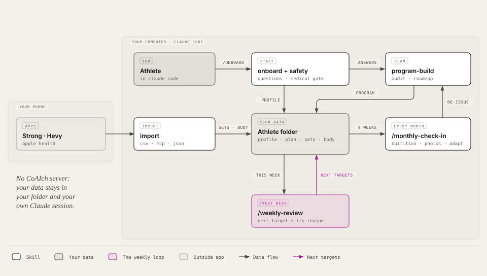

# CoAIch

**A strength and nutrition coach for Claude Code. Every number comes with its reason. Your data stays in your folder.**

> Preview, v0.2. "CoAIch" is a working name until the trademark search is done. The nutrition and photo
> safeguards are in code; their wording is a draft until a lawyer has reviewed it.

Most training apps tell you what to lift next and never say why. Most AI chats forget your last session the
moment you close them. CoAIch is a set of small Claude Code skills that keep your training in plain files in one
folder, and give every target a reason you can check: "you did 100 kg × 7, 7, 7, 7 with two reps to spare, so
next week is 102.5 kg."




**See [how it works](docs/how-it-works.md)**: the skills map, the weekly and monthly loop, and how each next target is decided.

## Install (30 seconds)

From inside Claude Code:

```
/plugin marketplace add <org>/coaich
/plugin install coaich@coaich
```

From a clone of this repository: `/plugin marketplace add ./path/to/coaich`, then the same install line.

Then, in an empty folder that will hold your training:

```
/onboard
```

It asks a few questions (about 3 minutes), runs the medical check, writes your profile and builds your first
program.

## Try it on the demo athlete

`examples/demo-athlete` is "Sam", a fictional intermediate lifter with 12 weeks of training in 2030. It was made
the way your folder grows: the intake answers in `profile.md` went through `program_build.py` (an upper/lower
split, 4 days × 60 min), then each week Sam trained to the engine's targets, imported the week from Strong, and
ran the weekly review (11 check-ins in `check-ins/`, every step in `log.md`). Sam also asked for help with food:
`nutrition.py` set targets for a slow lean gain (`plan/nutrition.md`), Sam weighs in most mornings, and each
check-in carries the weight-trend line. Photos are off (there are no images in this repository). Two sessions
are missed, one night is bad, the deadlift stalls from week 8, the overhead press slips, a calf exercise gets cut
back after two misses, and program week 7 is the easy week (2030-W09: easy weeks count in sessions done, so the
missed session moves it one calendar week later). The last week (2030-W13) is imported but not reviewed yet.

```
cd examples/demo-athlete
claude
> /weekly-review
  (the demo lives in 2030: when asked, say the week is 2030-W13)
```

You get a table per session: last target, what Sam did, the grade, next week's target and why. For example:

```
| lower-a-1 | Barbell Squat | 95×10·10·9·8 | 95×10·10·9·8 | met | 95×10·10·10·8 | Target met: same weight, one more rep on set 3 (9 → 10). |
| upper-a-3 | Standing Military Press | 40×12·9·9 | 40×10·9·8 | missed | 40×12·9·9 | Missed, but a rep record against last time: repeat the target. |

Summary: targets met 18/21 (86 %) · 3 go up · 18 change · 3 stay the same · 2 need your OK
Hit rate, last 4 weeks: 85 % (n=79); healthy band 70–85 % → healthy.
Weight trend, 4 weeks to 2030-03-31: +0.20 kg a week (+0.25 %), 26 weigh-ins; gain band +0.12 to +0.50 % → on track.
```

Then it asks you to confirm, writes next week's targets and a check-in. After that, `/monthly-check-in` (say the
date is 2030-03-31) reviews Sam's month:

```
| 2030-W11 | full | 3/4 | 14/16 | 88 % |
| Barbell Bench Press - Medium Grip | 93.3 kg | 93.3 kg | +0.0 % |
- The block ends with program week 14 (an easy week): re-issue the program for week 15 (`reissue`), with any swaps the athlete wants.
- Placement promised an Advanced offer from week 6: offer it (`reissue --promote`; it needs squat and bench sets in the log).
Targets in force since 2030-01-07: phase gain (0.25 % a week) · 2,900 kcal · protein 140 g · fat 81 g · carbs 403 g.
```

Muscles below the usual coaching band are listed for information only: nothing changes because of them.

Every change you accept goes into `plan/changes.md` with the band that says it worked; the next monthly check-in
grades it. The demo is generated by
`plugin/scripts/demo_athlete.py` (seeded, so it is the same every time; a test checks the committed copy is
current).

## Why these skills exist

**The coach doesn't know you.** A generic program ignores your history, your days and your sore knee.
→ `/onboard` asks once, writes `profile.md`, and every skill reads it.

**Nobody checks whether you should be lifting at all.** → `safety` runs before any program: a medical
warning you must accept, a short health list that can stop the plan until a doctor clears you, and a red-flag
pain rule that keeps exercises off a painful area until it has been checked.

**Your history is stuck in an app.** → `import` brings sessions in from a Strong CSV export, Hevy (the MCP
server or its CSV export) and Apple Health (a Health Auto Export file) into plain CSV files.

**Targets with no reasons.** → `progression` grades each exercise and proposes next week's load and reps, with
the rule that fired. `weekly-review` runs the loop and asks you before it changes anything.

**Plans that are never questioned.** → `program-audit` checks a program against the evidence.

**Changes nobody checks.** Coaches change things and never look back. → every applied change lands in
`plan/changes.md` with the band that says it worked, and `/monthly-check-in` grades it a month later: keep,
adjust or revert.

**Life gets in the way.** A sore shoulder, a busy fortnight, a trip. → `adapt` rebuilds around the pain (a red
flag sends you to a professional and leaves the area out) or the constraint, and back to normal after.

**No long view.** → `roadmap` lays out the year: phases with gates, program blocks, easy weeks.

**Food advice that ignores who it is talking to.** → `nutrition` sets calories, protein, fat and carbs with every
step shown, a day of meals from your diet and allergies, and corrects them from your weight trend. Safeguards in
code: 18+ only, an eating-disorder question first, never below resting needs, a loss cap that depends on body fat.

**Progress you can't see week to week.** → `physique` (opt-in, 18+) rates muscle groups in your own progress
photos, compares them over time and turns a goal look into training priorities.

## Skills

User-invoked (you type them): `/onboard`, `/weekly-review`, `/monthly-check-in`.

Model-invoked (Claude reaches for them, or you name them): `safety`, `import`, `program-build`, `progression`,
`program-audit`, `nutrition`, `physique`, `adapt`, `roadmap`.

| Skill | What it does | Script |
|---|---|---|
| `onboard` | Sets up your folder and runs the intake. Once, or again to redo answers. Your level comes from the program builder's placement, never from a guess. | `athlete_folder.py`, `program_build.py --place` |
| `safety` | Medical gate and red-flag pain rule. Runs before any plan. One doctor's clearance lifts the stop items of that intake. | — |
| `import` | Strong CSV, Hevy (MCP or CSV) → `data/sets.csv`, `data/sessions.csv`; Apple Health → `data/health.csv`, `data/body.csv`. Safe to re-run. | `import_strong.py`, `import_hevy.py`, `import_apple_health.py`, `exercise_map.py` |
| `program-build` | Builds a program from your profile, explains every choice and passes the audit. | `program_build.py` |
| `progression` | Grades last week and sets next week's targets, each with a reason. Spine-loaded increases and cuts need your OK. | `progression.py` |
| `weekly-review` | The weekly loop: import, grade, propose, ask, apply, check-in; with nutrition on, one weight-trend line. | `progression.py`, `nutrition.py trend --line` |
| `program-audit` | Pressure-tests a program, yours or a generated one, against the evidence. | `program_audit.py` |
| `monthly-check-in` | Four weeks of trends, past changes graded against their bands, next month's program and roadmap position, with your OK. | `monthly_check_in.py`, `changes.py` |
| `adapt` | Pain (red flag → a professional, the area left out; otherwise safer swaps), fewer days, less time or travel, then back to normal. Every version passes the audit. | `adapt.py` |
| `roadmap` | A dated macrocycle: phases with gates, mesocycles, projected weeks with their types. Re-plans when a gate is passed or missed. | `roadmap.py` |
| `nutrition` | Calories, protein, fat and carbs, a day of meals from your diet and allergies, and corrections from your weight trend. 18+ only; safeguards in code (lawyer review pending). | `nutrition.py` |
| `physique` | 18+ and opt-in only. Rates muscle groups in your progress photos, compares sets, gives a rough body-fat range if you ask, and turns a goal physique into training priorities. Removes your face and the photo's location data on your computer before Claude sees it. | `photos.py` |

Every script is Python 3.9+ standard library only, works offline and reads and writes the folder through
`scripts/athlete_folder.py`.

## Your folder

```
my-training/
  coaich.md          settings + safety record
  profile.md         your intake answers
  plan/CURRENT.md    what is in force today
  plan/program.json  your program
  plan/targets/      one targets file per week
  plan/roadmap.md    phases with gates, blocks, weeks
  plan/changes.md    every plan change with its success band
  plan/nutrition.md  calorie and macro targets + a day of meals (optional)
  data/sets.csv      one row per set
  data/sessions.csv  one row per session
  data/body.csv      weight, waist, body fat (one row per date and source)
  data/health.csv    steps, sleep, heart-rate data
  data/exercise_map.csv  your exercise names → catalogue ids
  photos/            progress photos by date + ratings.md (opt-in, git-ignored)
  check-ins/         weekly and monthly check-ins
  log.md             one line per skill run
```

The full contract is [docs/athlete-folder.md](docs/athlete-folder.md). Keep the folder anywhere, or make it its
own git repository.

## Safety and privacy, in plain words

- **CoAIch does not replace a doctor.** You accept that before anything else. Some health answers stop the plan
  until you confirm, in one exact sentence, that a doctor has cleared you. Under 16: no program.
- **Your data passes through your own Claude session**, so Anthropic processes it under your account's terms.
- **Nothing goes to a CoAIch server.** There is no CoAIch server and no telemetry.
- **Other services only when you turn them on:** Hevy, Apple Health, and later USDA or PubMed.
- Raw exports and photos are git-ignored in a new folder.
- **Calorie targets and photo reviews share one wellbeing gate:** 18+ only, off for anyone who reports an
  eating-disorder history (or would rather not say), and paused whenever you say something worrying about food
  or your body, until you ask for them back. Pregnancy turns calorie targets off.
- **Photos are opt-in, and your face comes off first.** Your own computer cuts each photo just below the chin (or
  covers the face, if you prefer) before Claude sees it; Claude never opens the original. Only that copy is kept,
  in your folder, without location or camera data. Your original stays where you had it. Reviews rate muscle groups, never looks; body fat only as a rough range.

## Licence

[AGPL-3.0](../LICENSE). Contributions need the CLA in [docs/CLA.md](../docs/CLA.md) (draft, lawyer review
pending).

The CoAIch iPhone and Watch app runs the same rules on your phone. Waitlist: *link coming*.
