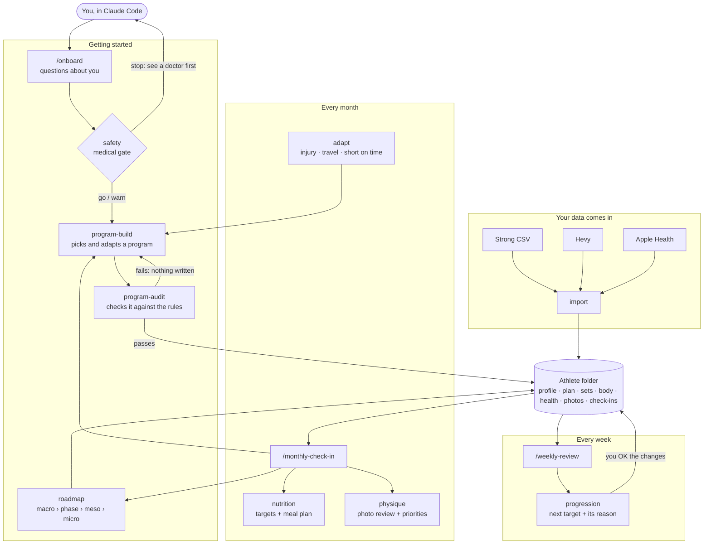
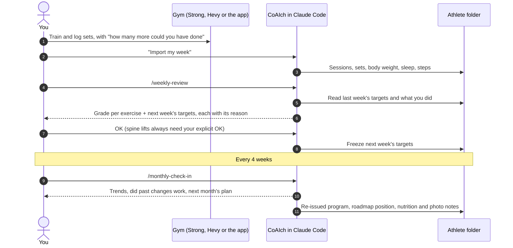
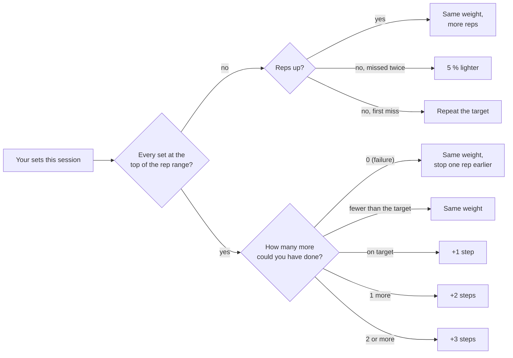

# How CoAIch works

Everything lives in one **athlete folder** on your computer. Skills read it, change it through small scripts,
and explain every number they write. Nothing goes to a CoAIch server: there isn't one.

<picture>
  <source media="(prefers-color-scheme: dark)" srcset="how-it-works-dark.svg">
  
</picture>

## The skills

## The training loop

## How a next target is decided

Steps are capped by your level and your equipment (a lower-body barbell never jumps more than 10 kg at once).
